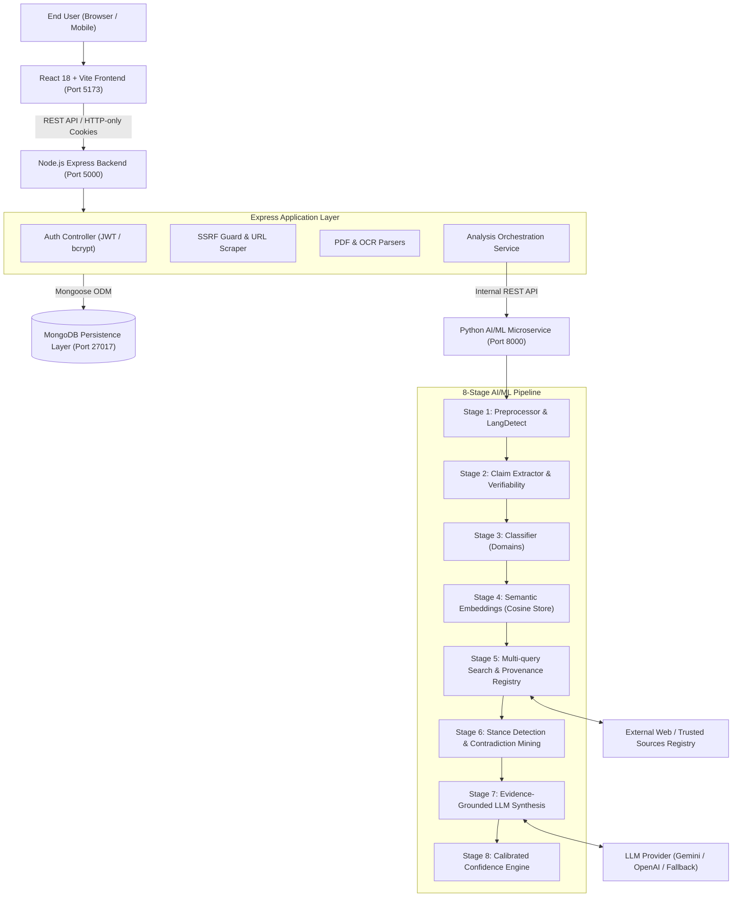

# TruthLens AI — Evidence-Based Misinformation Analyzer

> **"Evidence first, verdict second."**  
> An AI-powered, multi-modal fact-checking assistant that extracts verifiable factual claims from text, news URLs, screenshots, and documents; retrieves independent evidence; compares corroborating and contradictory sources; and presents transparent, calibrated assessments with zero hallucinated citations.

---

## 1. System Architecture

TruthLens AI decouples presentation, application orchestration, and AI/ML processing into modular services:



---

## 2. Technology Stack

### Frontend (`/client`)
- **React 18** with **Vite** & **TypeScript**
- **Tailwind CSS** with full Dark Mode support
- **Lucide React** icons
- **React Router v6**
- **Recharts** for empirical dashboard analytics & distribution visualizers
- **Axios** centralized client with interceptors

### Backend (`/server`)
- **Node.js** & **Express.js** with **TypeScript**
- **MongoDB** & **Mongoose** (User, Analysis, Claim, Evidence, Source, Feedback)
- **JWT Authentication** via secure HTTP-only cookies and Authorization headers
- **bcryptjs** (cost factor 12) password hashing
- **Zod** request schema validation
- **Multer** controlled file uploads with strict MIME filtering
- **SSRF Guard** (`ipaddr.js`): blocks loopback, private RFC 1918 subnets, and cloud metadata (169.254.169.254)
- **pdf-parse** & **tesseract.js** for document and screenshot text extraction
- **Helmet**, **CORS**, and **express-rate-limit**

### AI/ML Microservice (`/ai-service`)
- **Python 3.12** & **FastAPI**
- **Pydantic v2** & **pydantic-settings**
- **scikit-learn** TF-IDF vectorizer + subword n-grams for semantic cosine similarity
- **Sentence Transformers** (`all-MiniLM-L6-v2`) optional plugin
- **DuckDuckGo Search** (`duckduckgo-search`) & Trusted-Source Registry matching
- **BeautifulSoup4** for safe DOM cleaning
- **Multi-Factor Calibrated Confidence Engine**

---

## 3. Four Input Modalities

1. **Text & Social Media Statements:** Paste forwarded WhatsApp rumors, tweets, or speeches. The system normalizes whitespace and isolates atomic verifiable claims.
2. **Article URL:** Enter any public news link. The backend validates the URL against SSRF threats, strips extraneous HTML/scripts, extracts article text and publisher metadata, and cross-checks claims against independent reporting.
3. **Image & Screenshot OCR:** Upload JPG, PNG, or WebP screenshots of viral posts. Optical character recognition extracts readable text with a disclaimer that OCR text does not prove image authenticity.
4. **PDF & Document Parsing:** Upload reports up to 20 pages (max 10MB) with memory-safe text extraction.

---

## 4. Controlled Assessment Statuses

TruthLens AI enforces a controlled vocabulary for claim assessments:

| Status | Meaning |
| :--- | :--- |
| `SUPPORTED` | Relevant, credible evidence directly corroborates the factual claim. |
| `REFUTED` | Relevant, credible evidence directly contradicts or disproves the claim. |
| `MIXED` | Important evidence supports some aspects but contradicts or qualifies others. |
| `INSUFFICIENT_EVIDENCE` | Available evidence is insufficient to verify. **The system never assumes a claim is false simply because proof is missing.** |
| `OUT_OF_CONTEXT` | Statement references genuine figures or events but omits essential qualifiers. |
| `NOT_VERIFIABLE` | Statement is a subjective opinion, future prediction, or rhetorical expression unsuited for empirical verification. |

---

## 5. Calibrated Confidence Metric

Rather than producing arbitrary hallucinated percentages (e.g. "97% true"), TruthLens AI derives confidence from transparent empirical signals:

$$\text{Confidence} = 0.25 \cdot S_{\text{sources}} + 0.20 \cdot S_{\text{primary}} + 0.25 \cdot S_{\text{agreement}} + 0.15 \cdot S_{\text{directness}} + 0.15 \cdot S_{\text{coverage}}$$

- **Independent Sources:** Counts distinct publisher domains (3+ domains = 1.0).
- **Primary Source:** Presence of official gazettes, court decrees, or peer-reviewed journals.
- **Agreement Ratio:** Degree of consensus between supporting and refuting sources.
- **Directness:** Direct quotes and numerical matches vs vague contextual mentions.

---

## 6. Repository Structure

```text
Truth lens/
|-- client/                     # React 18 + Vite + TypeScript Frontend
|   |-- src/
|   |   |-- api/                # Axios API client
|   |   |-- components/         # Navbar, Footer, Badges, ClaimCard, Modals
|   |   |-- context/            # AuthContext, ThemeContext
|   |   |-- pages/              # Landing, NewAnalysis, Results, Dashboard, etc.
|   |   |-- types/              # TypeScript definitions
|   |   |-- App.tsx
|   |   `-- main.tsx
|   |-- package.json
|   |-- tailwind.config.js
|   `-- vite.config.ts
|-- server/                     # Node.js + Express Backend
|   |-- src/
|   |   |-- config/             # DB, environment, constants
|   |   |-- controllers/        # Auth, Analysis, Claim, User, Feedback
|   |   |-- middleware/         # Auth, RateLimiter, Upload, SSRF, Validate
|   |   |-- models/             # Mongoose schemas (User, Analysis, Claim, etc.)
|   |   |-- routes/             # API v1 routes
|   |   |-- services/           # AI Client, URL Fetcher, OCR, Export
|   |   `-- index.ts
|   |-- tests/                  # Automated Jest & Supertest test suite
|   |-- package.json
|   `-- tsconfig.json
|-- ai-service/                 # Python FastAPI AI/ML Microservice
|   |-- app/
|   |   |-- core/               # Settings, structured logging
|   |   |-- data/               # Curated trusted sources registry (JSON)
|   |   |-- models/             # Pydantic request/response schemas
|   |   |-- pipeline/           # 8-stage modular NLP pipeline
|   |   |-- providers/          # Gemini, OpenAI, and deterministic Fallback
|   |   `-- main.py             # FastAPI application
|   |-- tests/                  # Pytest unit tests
|   |-- evaluate.py             # Benchmark evaluation script
|   `-- requirements.txt
|-- docs/                       # Architecture, API specs, Security, Evaluation docs
|-- docker-compose.yml          # Multi-container local orchestration
`-- README.md
```

---

## 7. Local Installation & Setup

### Prerequisites
- **Node.js** v18+ (v20+ recommended)
- **Python** 3.10+ (tested on Python 3.12)
- **MongoDB** running locally on port 27017 or via Docker

### Step 1: Start MongoDB
Using Docker:
```bash
docker run -d -p 27017:27017 --name truthlens-mongo mongo:latest
```
*(Or start your local MongoDB service.)*

### Step 2: Set Up Python AI Microservice
```bash
cd ai-service
python -m pip install -r requirements.txt
cp .env.example .env

# Run unit tests
python -m pytest tests/test_pipeline.py -v

# Run benchmark evaluation suite
python evaluate.py

# Start FastAPI server (Port 8000)
uvicorn app.main:app --host 0.0.0.0 --port 8000 --reload
```

### Step 3: Set Up Express Backend
In a new terminal:
```bash
cd server
npm install
cp .env.example .env

# Run automated tests
npm test

# Start backend server in dev mode (Port 5000)
npm run dev
```

### Step 4: Set Up React Frontend
In a third terminal:
```bash
cd client
npm install

# Start Vite development server (Port 5173)
npm run dev
```

Open `http://localhost:5173` in your browser.

---

## 8. Running with Docker Compose

To launch the complete application stack (MongoDB, Python AI Microservice, Express API, and Nginx React Frontend):

```bash
docker-compose up --build
```
- Frontend: `http://localhost`
- Backend API: `http://localhost:5000`
- AI Microservice: `http://localhost:8000`

---

## 9. Test Execution Summary

### Python AI Pipeline Tests (`pytest`):
```text
tests/test_pipeline.py::test_preprocessor_whitespace_and_language PASSED
tests/test_pipeline.py::test_sentence_splitting_with_abbreviations PASSED
tests/test_pipeline.py::test_claim_extraction_and_verifiability PASSED
tests/test_pipeline.py::test_classifier_categories PASSED
tests/test_pipeline.py::test_trusted_source_registry PASSED
tests/test_pipeline.py::test_evidence_ranking_and_stance PASSED
tests/test_pipeline.py::test_confidence_engine_calibration PASSED
tests/test_pipeline.py::test_insufficient_evidence_never_assumes_false PASSED
tests/test_pipeline.py::test_claim_assessor_full_pipeline PASSED
======================== 9 passed in 3.03s ========================
```

### Benchmark Evaluation Suite (`evaluate.py`):
```text
Accuracy (Grounding Status): 100.0% (5/5)
Median Latency:              4.0 ms
95th-Percentile Latency:     36.0 ms
```

### Express Backend Tests (`jest`):
```text
PASS tests/server.test.ts
  √ GET /health returns status healthy
  √ blocks localhost and loopback addresses (SSRF)
  √ blocks cloud metadata link-local endpoints (169.254.169.254)
  √ blocks private network IP ranges (10.0.0.1, 192.168.1.1)
  √ blocks forbidden protocols like file:// and gopher://
  √ generates structured JSON export correctly
  √ generates styled HTML export correctly
  √ rejects empty text analysis input with 400
  √ rejects invalid URL in URL analysis endpoint with 400
  √ returns 404 for non-existent API routes
Test Suites: 1 passed, 1 total (10 passed)
```

### Client Frontend Build (`vite build`):
```text
✓ built in 11.22s
dist/index.html    1.20 kB
dist/assets/*.css  41.22 kB
dist/assets/*.js   749.12 kB
```

---

## 10. License & Academic Attribution
TruthLens AI was designed as a production-grade full-stack research prototype. Built with an evidence-grounded architecture to empower researchers, educators, and citizens against digital misinformation.
