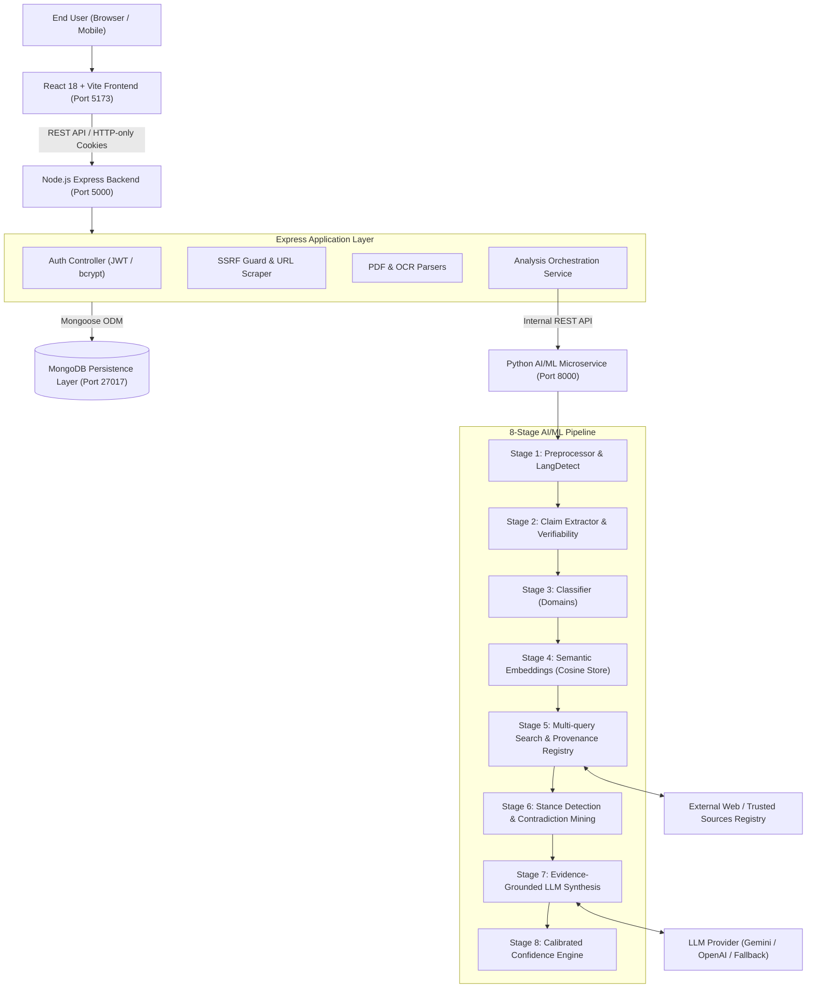
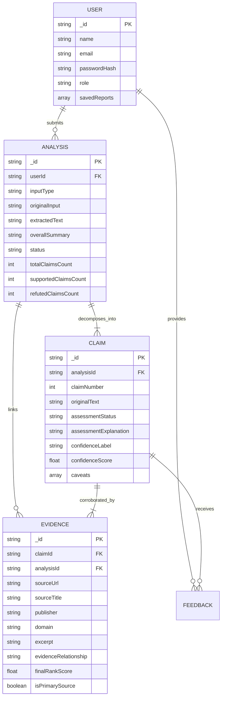

# TruthLens AI — System Architecture & Data Flow

## 1. High-Level Architecture Diagram

## 2. Core Principles
1. **Evidence First, Verdict Second:** Conclusions are strictly derived from retrieved evidence. If no sources exist, claims are marked `INSUFFICIENT_EVIDENCE` rather than assumed false.
2. **Untrusted Data Isolation:** User inputs, crawled websites, and uploaded documents are handled as untrusted text. No instructions within them are executed.
3. **Calibrated Confidence:** Transparent, multi-factor scoring based on independent domain counts, primary evidence, agreement consensus, and directness.

## 3. Database Entity Relationship Diagram

